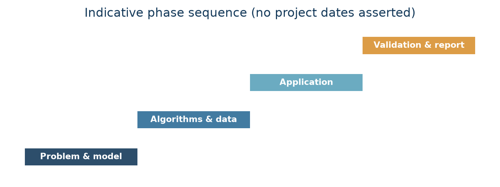

# CHAPTER 1. INTRODUCTION

## 1.1 Identification of Client / Need / Relevant Contemporary Issue

This is an academic demonstration project, not commissioned by a named client. Its motivating issue is the general planning task faced by a logistics network: a shipment may pass through multiple hubs, and choosing a locally attractive link does not necessarily minimize the total journey objective. A graph model makes the decision explicit and permits a route to be evaluated as an ordered sequence of connections. Because transport choices involve trade-offs, Meridian lets the user optimize one edge-weight dimension at a time—cost, distance or estimated time—rather than combining them without a declared policy.

The software is deliberately an educational simulator. It uses reproducibly generated, representative route weights, not carrier quotations, road restrictions, real schedules, customs data or live package tracking. No client interviews, surveys or field measurements were conducted, so the project makes no such claims. Its contemporary relevance is the need to reason transparently about network connectivity, route objectives, data structures and algorithm constraints when building decision-support software.

## 1.2 Identification of Problem

Given a loop-free directed weighted graph G = (V, E), a source s, destination t and a selected non-negative edge-weight function w, find a path from s to t whose total weight is minimum. If no path exists, report that the destination is unreachable. The total must be based on the selected metric, not on visual distance alone. A second problem is to determine when the assumptions of a chosen algorithm are not satisfied: Dijkstra is not valid for negative edge weights, while a reachable negative-weight cycle can make the minimum undefined for affected destinations.

The implementation problem also includes preserving enough predecessor information to explain a result, providing comparable execution counters, and communicating graph properties to a user. These are constraints on a valid solution, not claims about a production transport network.

For a path P = (v₀, …, vₖ), its selected weight is:

**W(P) = Σᵢ₌₀ᵏ⁻¹ w(vᵢ, vᵢ₊₁), and distₛ(t) = minₚ:s→t W(P).**

If no s→t path exists, distₛ(t) is ∞. If a cycle of negative total weight is reachable from s and can reach t, there is no finite minimum for t.

## 1.3 Identification of Tasks

The project tasks were to: (1) inspect and model a directed logistics graph with distinct cost, distance and time weights; (2) persist locations and routes in SQLite; (3) implement heap Dijkstra, array Dijkstra and Bellman–Ford with path predecessors; (4) validate non-negative-weight preconditions and negative-cycle behavior; (5) expose algorithms and management operations through a Flask JSON API; (6) build a browser UI for selection, visualization, comparison and analytics; (7) generate deterministic sample and benchmark graphs; and (8) test algorithms, API behavior and representative results. These tasks map to a single implementation chapter rather than separate chapters for architecture, algorithms or interface.

## 1.4 Timeline

No dated project log was available in the repository. The following is an indicative work sequence reconstructed from project deliverables, not a claim about actual calendar dates.

| Phase | Work package | Evidence / output |
|---|---|---|
| 1 | Define problem and graph model | Vertices, directed routes, selected weight semantics |
| 2 | Implement data and algorithms | SQLite schema, three shortest-path implementations |
| 3 | Integrate application | Flask endpoints, services and single-page interface |
| 4 | Evaluate and document | Automated tests, benchmark cases, analytics and report |

## 1.5 Organization of the Report

Chapter 1 establishes the need, solution-independent problem, tasks and indicative work sequence. Chapter 2 reviews graph representations, shortest-path methods, existing approaches and the academic problem/objectives. Chapter 3 compares design alternatives and describes the selected flow and implementation methodology. Chapter 4 presents the actual Flask, SQLite, graph, algorithm and UI implementation, followed by testing, results and limitations. Chapter 5 summarizes achievements and proposes future work. References, appendices and the User Manual follow the five chapters as in the local University format.
