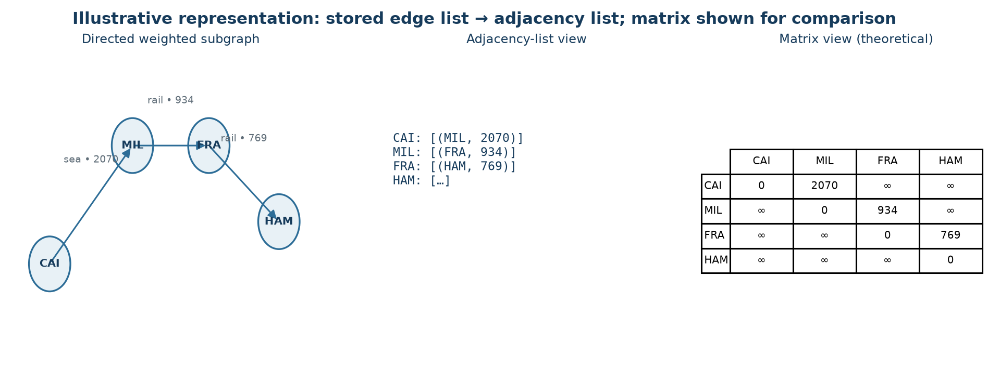

# CHAPTER 2. LITERATURE REVIEW / BACKGROUND STUDY

## 2.1 Timeline of the Reported Problem

The shortest-path problem arises in routing, transportation and communication networks. Its formal graph treatment predates modern web applications. Dijkstra published a label-setting shortest-path method in 1959; Bellman's work on routing in 1958 is an early source for repeated edge relaxation. These methods remain complementary: Dijkstra exploits non-negative weights, while Bellman–Ford handles negative weights and detects negative cycles. Later data-structures texts systematized priority queues, adjacency representations and complexity analysis. Contemporary software commonly combines these classical algorithms with persistent data, APIs and interactive presentation; Meridian is an instructional integration of those pieces rather than a novel shortest-path algorithm [1]–[4].

## 2.2 Existing Solutions

For a directed graph G = (V,E), an adjacency list stores each vertex's outgoing neighbours and weights; an edge list stores tuples (u,v,w); an adjacency matrix stores a V×V weight table. A list uses Θ(V+E) memory and supports neighbour iteration in Θ(out-degree(u)); a matrix uses Θ(V²) memory and provides constant-time edge lookup at the cost of scanning a full row for neighbours. The implementation uses both an edge list (database-derived routes) and a dictionary-backed adjacency list when algorithms traverse edges. The matrix is a theoretical comparison, not a live implementation.

**Table 2.1 – Graph representation trade-offs**

| Representation | Storage | Edge lookup | Neighbour traversal | Typical fit |
|---|---|---|---|---|
| Edge list | Θ(V+E) | Θ(E) without indexing | Θ(E) for all outgoing edges | Edge-relaxation algorithms |
| Adjacency list | Θ(V+E) | Θ(out-degree) in this list-based form | Θ(out-degree) | Sparse graphs and traversals |
| Adjacency matrix | Θ(V²) | Θ(1) | Θ(V) per vertex | Dense graphs / frequent direct lookup |

Let n = |V| and m = |E|. For a loop-free simple directed graph, 0 ≤ m ≤ n(n−1), and density is **ρ = m/[n(n−1)]**. In the seeded Standard case, ρ = 102/(25×24)=0.17. Average out-degree is **m/n = 4.08**. In-degree counts incoming directed edges; out-degree counts outgoing ones. A weakly connected component ignores edge direction for reachability, whereas a strongly connected component requires directed paths both ways between every pair in the component. One weak component does not imply strong connectivity; the seeded graph separately has one SCC and is therefore strongly connected.

### Dijkstra with a binary heap

Dijkstra is greedy: it repeatedly settles the unsettled vertex with the smallest tentative distance. Initialize d(s)=0 and d(v)=∞ otherwise; insert (0,s) into a min-priority queue. On extracting the smallest key, skip a stale duplicate or an already-settled vertex, then examine outgoing edges. Relax u→v when d(u)+w(u,v)<d(v); set d(v) and pred(v), and push the new key. The heap root is the current minimum, and push/pop cost O(log V) under the simple-graph assumptions. The implementation uses Python's min-heap and lazy duplicate entries rather than decrease-key. With adjacency lists, the common bound is O((V+E)log V); storage including graph, predecessor/distance maps and heap is O(V+E). Non-negative weights are essential to the greedy settling argument [1], [3], [5].

### Array-based Dijkstra

The array variant maintains tentative distances and repeatedly scans remaining vertices to find the minimum. Its minimum selection costs O(V) per settled vertex, for O(V²) selection work, plus O(E) relaxation work: O(V²+E), often stated as O(V²). The implementation still uses the adjacency list for outgoing edges, so storage remains O(V+E), not O(V²). On sparse graphs the repeated full scans can dominate; on dense graphs the O(V²) scan can be competitive with heap operations, with practical crossover depending on representation, runtime and workload. It also requires non-negative weights.

### Bellman–Ford

Bellman–Ford initializes distances similarly and scans every directed edge repeatedly. Each relaxation tests **d(v) > d(u)+w(u,v)**; after V−1 complete passes, all finite shortest paths (which can be made simple absent negative cycles) have been considered. If a pass makes no change, the implementation stops early. A further pass detects a reachable negative cycle. The source-based version uses O(VE) worst-case time and O(V+E) space; a virtual-source mode initializes all distances to zero to detect cycles anywhere in the graph. The code records predecessors, extracts a cycle, computes affected vertices and marks them −∞. This generality costs repeated full edge scans; it is not automatically preferable when all weights are non-negative [2]–[4].

## 2.3 Bibliometric Analysis

No systematic database search, citation export or bibliometric corpus was available, so publication counts, citation ranks and year-by-year bibliometric statistics are not asserted. A structured comparative review is more defensible for this project: it relates seminal shortest-path work and authoritative data-structures references to concrete implementation choices.

**Table 2.2 – Structured literature comparison**

| Source / approach | Key contribution used here | Strength | Limitation relevant to this project |
|---|---|---|---|
| Dijkstra (1959) [1] | Greedy label-setting shortest paths | Efficient when all selected weights are non-negative | Does not support negative weights |
| Bellman (1958) [2] | Routing formulated through iterative relaxation | Establishes a general relaxation perspective | Repeated passes can be expensive |
| Ford (1956) [3] | Network-flow / shortest-path foundations | Connects network problems to algorithmic optimization | Historical report; not a modern implementation guide |
| Cormen et al. [4] | Graph representations, heaps and complexity | Precise algorithmic reasoning and bounds | Abstract models do not predict Python wall-clock time |
| Python `heapq` documentation [5] | Min-heap operations used by implementation | Language-specific operational behavior | API documents data structure, not Dijkstra correctness |

The useful comparison is qualitative and algorithmic, not a numerical publication survey. The project evaluates whether representation and preconditions match the modeled task and then tests implementation behavior.

## 2.4 Review Summary

The reviewed methods establish a clear selection rule. Use a heap-based Dijkstra implementation when the selected objective has only non-negative weights and the graph is sparse. An array scan is a reasonable alternative for smaller or sufficiently dense graphs. Use Bellman–Ford if negative weights are permitted and a finite shortest path remains well-defined; detect negative cycles because no finite optimum exists for affected destinations. Adjacency lists suit the Standard network's 102 edges among 25 vertices and support local neighbour traversal. The edge list remains convenient for persistence and Bellman–Ford's repeated relaxation. The reviewed literature informs this design but does not make Meridian's synthetic weights operational evidence.

## 2.5 Problem Definition

For a persisted network, selected metric q ∈ {cost, distance, time}, source s and target t, compute a minimum-weight directed path using **wq(u,v)** from the corresponding route field. Return the ordered vertices, predecessor-derived hop sequence, selected total, and distance/cost/time totals for interpretation. Reject invalid nodes, metrics and algorithms; prevent Dijkstra on negative selected weights; distinguish unreachable targets from negative-cycle-affected targets. For comparison, execute valid algorithm variants on identical graph data and expose complexity metadata, edge checks and runtime observations. The scope excludes real-time network feeds, multi-objective optimization, capacities, inventory allocation and proof of real delivery outcomes.

## 2.6 Goals / Objectives

1. Model locations and directed transport links as G=(V,E), keeping cost, distance and time as distinct edge weights.
2. Implement and compare heap Dijkstra, array Dijkstra and Bellman–Ford with predecessor-based path reconstruction.
3. Enforce algorithm preconditions and report unreachable destinations and negative-cycle effects without presenting an invalid finite optimum.
4. Persist reproducible scenarios and expose route, analysis, comparison, benchmark, analytics and network-management operations through Flask/SQLite.
5. Validate algorithms using known cases, generated cross-check graphs and API tests; interpret measured timings as environment-dependent observations.
6. Deliver a UI that communicates the selected metric and algorithm result, while identifying the synthetic nature and limitations of the data.
