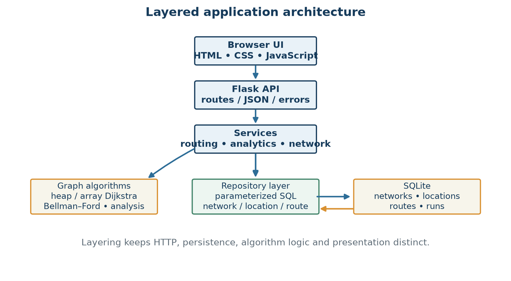
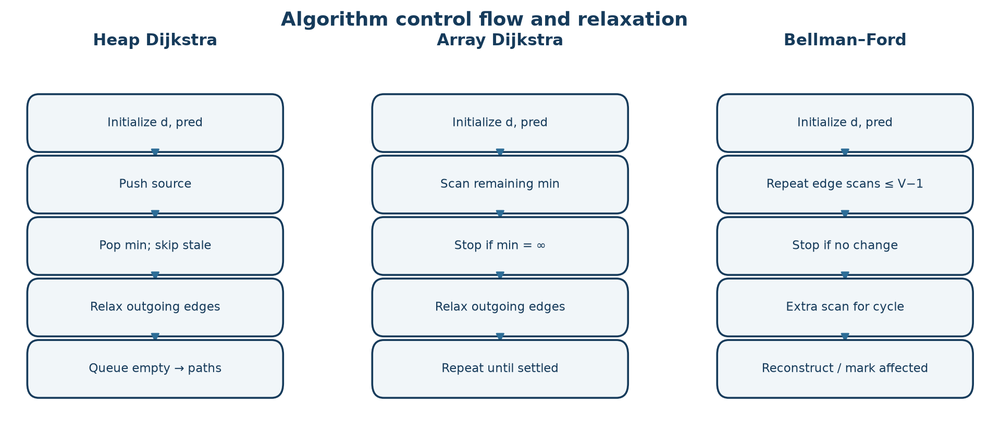

# CHAPTER 3. DESIGN FLOW / PROCESS

## 3.1 Evaluation and Selection of Specifications / Features

The essential features were selected to answer graph-algorithm questions rather than to maximize interface breadth: persistent directed locations/routes; a user-selected weight; three comparable shortest-path algorithms; path details and counters; negative-edge/cycle handling; reproducible scenarios and benchmark generators; and a visual interface for route selection and network properties. Optional management and analytics functions support experimentation by making the graph inspectable and editable in a local simulator. The JSON boundary follows the interoperable data-exchange concepts of RFC 8259 [8], without claiming a formal conformance audit.

The implementation requirements are: (a) preserve edge direction, (b) keep the three objectives separate, (c) store enough metadata to explain each hop, (d) validate endpoint and weight constraints, (e) expose algorithm limitations, and (f) make tests repeatable. This corresponds to the functional-suitability and performance-efficiency vocabulary of ISO/IEC 25010:2023, used only as a design reference [9].

## 3.2 Design Constraints

**Technical constraints.** The app uses Python, Flask, SQLite and plain browser technologies. No external map or chart service is required. The map is a stylized projection, not a geographic routing engine. SQLite uniqueness means parallel edges with the same ordered endpoints are not represented. Graphs are loaded into memory before shortest-path calculation.

**Algorithmic constraints.** Dijkstra requires non-negative weights for the selected metric, even if another metric on the same route is non-negative. Bellman–Ford can handle negative edges but cannot produce a finite minimum to vertices affected by a reachable negative cycle. The standard graph is directed; two-way corridors are two directed records. Negative cost credits exist only in testing scenarios.

**Data and evaluation constraints.** The generated transport model estimates route measures from coordinates and fixed mode constants. It omits schedules, congestion, capacity, reliability, customs and live prices. Benchmark timings depend on Python/runtime/hardware and graph ordering; hardware metadata for the supplied screen values is unavailable. The application does not implement authentication or claim production security certification.

## 3.3 Analysis of Features and Finalization Subject to Constraints

**Table 3.1 – Feature decision traceability**

| Requirement | Chosen feature | Verification evidence |
|---|---|---|
| Explain a route | Predecessor map, route reconstruction and hop rows | Algorithm tests and route API |
| Compare costs, time and distance | Metric selector; distinct weights per edge | `GraphData.edges(metric)` |
| Handle negative testing weights safely | Dijkstra precondition check and Bellman–Ford cycle detection | Algorithm/API tests |
| Demonstrate graph-scale trends | Deterministic random and BF worst-case graph generators | Benchmark tests and UI |
| Support inspectable model data | SQLite-backed network/location/route CRUD | API validation tests |
| Communicate connectivity | Density, degree, weak and strong components | Graph analysis and dashboard |

Two route alternatives were considered. A matrix-oriented design would use Θ(V²) memory and constant-time edge lookup, then array-scan Dijkstra in O(V²+E); it may be attractive for dense small graphs but wastes space on sparse networks. The selected sparse design stores edges and builds adjacency lists, using heap Dijkstra with O((V+E)logV) expected textbook work under non-negative weights. Bellman–Ford remains an implemented alternative when negative weights require general relaxation. A third conceptual production direction—A* or preprocessed routing—was not implemented because no heuristic/real geographic road graph or large operational workload is present.

## 3.4 Design Flow

The flow begins with a request carrying network ID, source, target, algorithm and metric. The API validates the JSON body and delegates to services. Services load the network's vertices and route rows, map the metric to an edge weight, compute graph properties/recommendation, run the chosen algorithm, reconstruct a path and serialize result/diagnostic data. Flask returns JSON; the front end renders map, route details, charts and messages. Analytics use stored routes and recent run records, while benchmark endpoints construct generated graphs independently.

The route path reported by the backend, not the SVG map geometry, is authoritative. The model separates stored route data, shortest-path computation, API transport and presentation. Error objects cross the service boundary with status and code; unexpected exceptions are logged by the application factory.

## 3.5 Design Selection

The selected design keeps pure algorithm functions in `backend/algorithms`, persistence in `backend/db`, orchestration in `backend/services`, HTTP parsing in `backend/routes`, and UI concerns in `frontend`. This separation enables textbook cases to test the algorithms without Flask or SQLite and enables API tests to exercise validation and serialization. A relational schema enforces local integrity constraints; Python structures are derived at request time and discarded after calculation.

**Table 3.2 – Design alternatives and decision**

| Alternative | Advantages | Costs / restrictions | Status |
|---|---|---|---|
| Adjacency list + heap Dijkstra | O(V+E) graph storage; efficient sparse traversal | Heap operations; invalid for negative weights | Implemented and recommended on sparse non-negative graphs |
| Matrix + array Dijkstra | Simple selection; dense-graph scan can be competitive | Θ(V²) memory and O(V²) scan even for sparse graphs | Conceptual comparison; not the repository representation |
| Edge-list Bellman–Ford | Negative-edge support and negative-cycle detection | O(VE) worst-case repeated scans | Implemented; selected when negative edges require it |
| Real-time road routing service | Could reflect live constraints if integrated | Requires external data/service and operational controls | Not implemented; future option only |

The recommender does not benchmark every possible implementation before every route. It derives a rule from metric-specific negative weights, graph density and size. This is a deterministic heuristic, not a proof of universal runtime optimality.

## 3.6 Implementation Plan / Methodology

Implementation proceeds from schema and reproducible sample data to pure algorithms, then graph-property analysis, route services and API endpoints, followed by browser views. Validation uses known examples, negative-cycle and unreachable cases, random positive graphs cross-checked across all three algorithms, and API tests for scenarios, CRUD, errors and benchmarks. Benchmarks report medians and operation counts for generated cases; correctness checks remain separate from timing claims.

The resulting data flow is summarized below. A source/target request is resolved against graph nodes; metric selection maps to `cost_usd`, `distance_km` or `time_hours`; a negative cycle or unreachable target changes the status instead of returning a fabricated path.

The design is intentionally small enough for a third-semester data-structures project: it demonstrates representation trade-offs, priority-queue versus scan-based minimum selection, repeated edge relaxation, predecessor tracking and empirical complexity trends without representing its synthetic input as real operations data.
