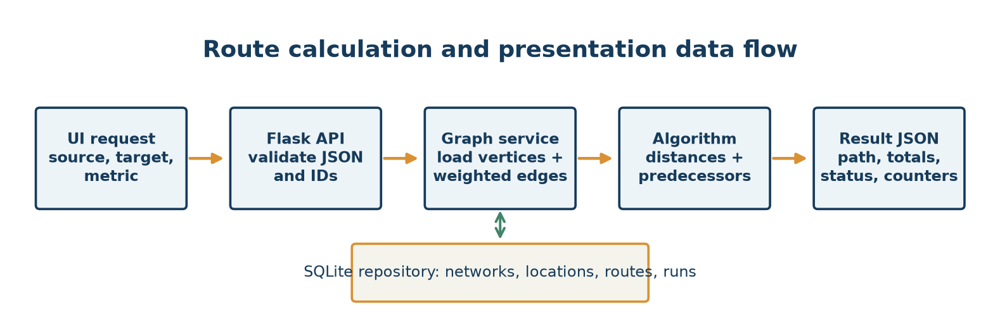
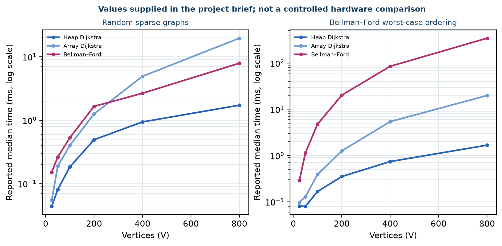
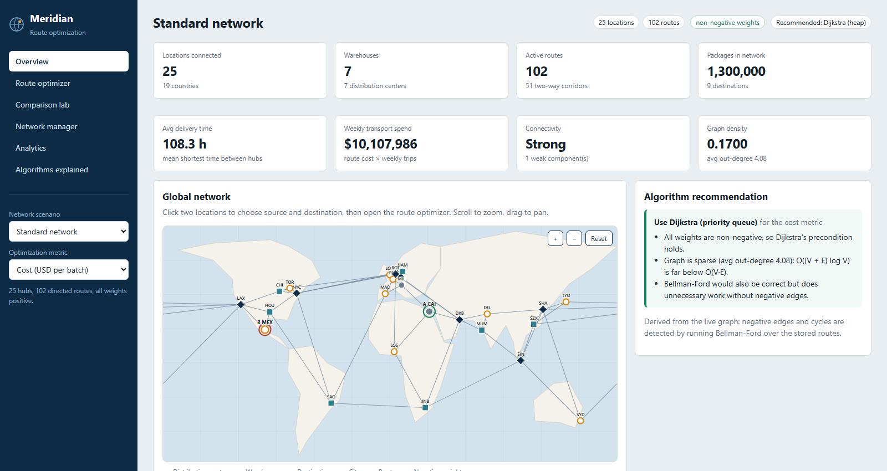
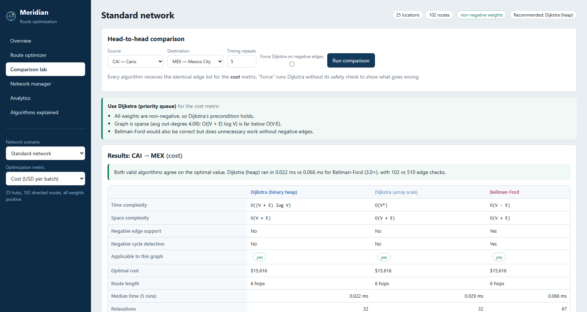
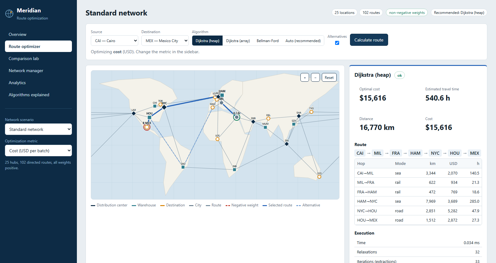
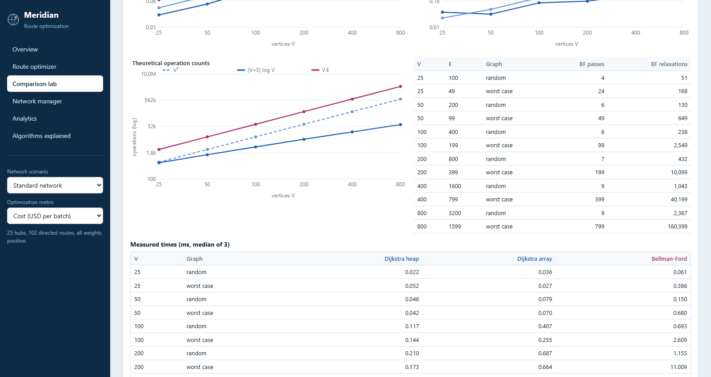
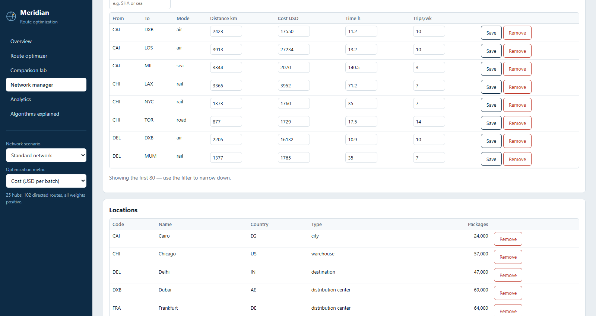
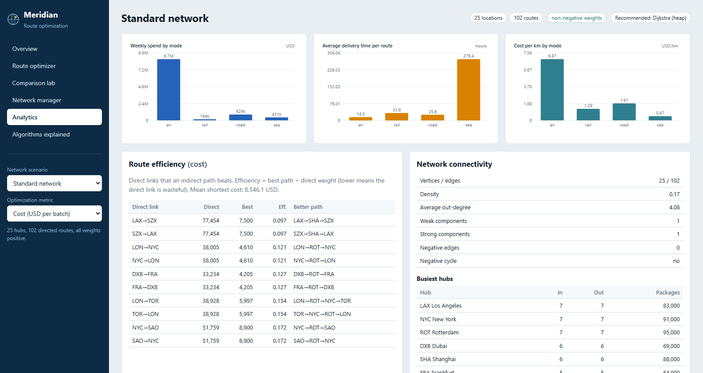
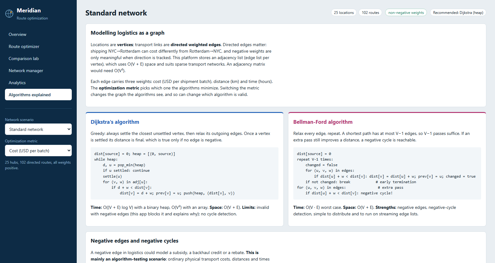
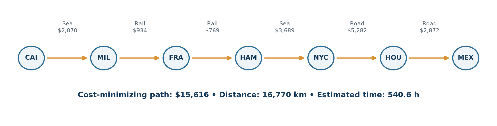

# CHAPTER 4. RESULTS ANALYSIS AND VALIDATION

## 4.1 Implementation of Solution

### 4.1.1 Overall System Architecture

Meridian is a layered Flask application. `run.py` invokes `create_app`; the factory initializes the schema/seeds missing scenarios, registers the API blueprint and serves `frontend/index.html` plus static assets. API routes call service functions, which read SQLite through a repository and invoke pure graph algorithms. Browser JavaScript calls JSON endpoints, then renders the active view. This is a single-page interface, not a separate frontend build. The local project tests and sample screenshots use an isolated database under the report output; the existing application database was not changed.

### 4.1.2 Flask Application and API Layer

`backend/app.py::create_app` constructs Flask, configures the database path and maps API errors to JSON. `backend/routes/api.py` defines endpoints for health/theory, network list/generation/reset/delete, graph/summary/analysis/analytics, route, compare, benchmark and location/route CRUD. Request bodies must be JSON objects for the main APIs. `ApiError` carries an HTTP status and code; malformed arguments, unknown resources, duplicates and invalid weights are reported with suitable 400/404/409/422 responses. Unexpected exceptions are logged and returned as generic 500 errors.

### 4.1.3 Graph Construction and Representation

The repository returns locations and directed route rows. `GraphData` stores a node-code list, a code-to-location dictionary and an ordered-pair route map. For a selected metric, `GraphData.edges` produces `(src,dst,weight)` tuples. `common.py::build_adjacency` creates `dict[node] -> list[(neighbour,weight)]`. This combination keeps route rows convenient for persistence and edge-relaxation while supporting outgoing-neighbour traversal for Dijkstra. No adjacency matrix is used by the running algorithm code.

The density is `E/[V(V−1)]` for this no-self-loop graph; average out-degree is E/V. `weak_components` uses disjoint sets with direction ignored. `strong_components` uses iterative Kosaraju on the forward and reverse adjacency structures. Each property answers a different structural question: density describes possible directed links occupied, average degree describes mean outgoing options, weak connectivity ignores orientation and SCC count respects orientation fully.

### 4.1.4 Database and Data Handling

`database.py` declares four tables: `networks`, `locations`, `routes` and `runs`. Primary keys, foreign keys, uniqueness, CHECK constraints and network indexes support integrity and lookups. A route is directed; bidirectional creation inserts two rows. Location deletion removes incident route rows in repository logic. `runs` records algorithm, metric, endpoints, status, total, time, relaxations and iterations. SQLite is the project's single-process demo persistence layer; no distributed database, authentication system or live carrier integration is claimed.

### 4.1.5 Dijkstra's Binary-Heap Implementation

`algorithms/dijkstra.py::dijkstra(..., variant="heap")` rejects negative selected weights by default, builds adjacency lists and initializes `dist[source]=0`, all other distances to infinity, and all predecessors to `None`. It pushes `(distance,node)` pairs into `heapq`. The smallest tentative key is extracted; stale entries are discarded using a settled set. For each outgoing edge, the algorithm counts an edge check, computes the candidate distance and relaxes a strictly shorter label. The updated predecessor is retained for path reconstruction. Lazy insertion can place duplicate keys in the heap; it avoids an explicit decrease-key implementation. For simple graphs, this yields the common O((V+E)logV) time bound and O(V+E) total storage. It is valid only for non-negative weights.

### 4.1.6 Array-Based Dijkstra Implementation

The same function's `variant="array"` maintains remaining vertices and obtains the minimum with a linear `min(remaining, key=dist.__getitem__)` scan. The implementation counts each scan's remaining-set size, then relaxes outgoing adjacency entries. Worst-case selection is O(V²), edge work O(E), hence O(V²+E); the graph and distance structures still occupy O(V+E) space. For an unreachable remainder, it stops as soon as the minimum distance is infinite. Its validity condition is the same as heap Dijkstra's.

### 4.1.7 Bellman–Ford Implementation

`bellman_ford.py::bellman_ford` works over the edge list. With a specified source, it performs at most V−1 relaxation passes; with `source=None`, all distances start at zero and V passes are allowed for global cycle analysis. A no-change pass sets `early_termination` and stops. If all passes were needed, a further scan checks whether an edge can still improve a reachable distance. Predecessors are used to walk into and extract a cycle; affected downstream vertices are found by graph traversal and assigned −∞. The worst-case time is O(VE) plus a linear detection scan, and aggregate graph/distance/predecessor storage is O(V+E).

### 4.1.8 Algorithm Dispatch and Route Reconstruction

`services/graph.py::run_algorithm` maps `dijkstra_heap`, `dijkstra_array` and `bellman_ford` to implementations. `auto` in route calculation first asks `recommend`; negative selected edges lead to Bellman–Ford, a negative cycle is surfaced as invalid/no finite optimum, and non-negative data leads to a Dijkstra variant. Dijkstra errors are converted to a 422 response with a recommendation. `ShortestPathResult.path_to` follows predecessor links back to the source and refuses unreachable or negative-infinity destinations. `describe_path` looks up each directed edge and sums all three measures independently. Optional alternatives remove one best-path link at a time and re-solve; these are single-link-failure alternatives, not an exhaustive k-shortest-path algorithm.

### 4.1.9 Network Manager

The network service validates location codes, kinds, coordinates and package counts; route endpoints, mode, distance, cost, time and weekly trips; and duplicate rows. Route creation can calculate omitted measures using coordinates and mode constants; a bidirectional option inserts a reverse edge. The UI/API supports edit and removal; removing a location removes its incident routes. Built-in scenarios can be reset but not deleted; generated networks can be deleted. Negative synthetic cost values can be entered for algorithm demonstrations. No production transport record was changed for this report.

### 4.1.10 Route Optimizer

The interface offers network scenario, metric, source, target, algorithm and alternative-route controls. Overview map points can select endpoints; the optimizer then calls the route API and presents the path, total for the selected metric, a hop table, counters, runtime and alternatives where available. The map is a coordinate projection for orientation, while the path is calculated from stored edges. A selected cost path does not imply minimum distance or minimum time; all three total values are shown to make that distinction explicit.

### 4.1.11 Comparison Lab

The comparison service runs both Dijkstra variants and Bellman–Ford against identical graph data, reports applicable status and complexity metadata, and calculates repeated-run medians (repeat count is bounded). For negative weights, Dijkstra is normally marked inapplicable; a forced mode exists to demonstrate incorrect behavior, not to recommend it. Agreement indicates matching totals among applicable, unforced algorithms for that instance; it is not a proof for every graph.

### 4.1.12 Scaling Benchmark

`routing.py::benchmark` accepts sizes from 3 to 2,000, repeats and average degree. It compares all three methods on deterministic positive random graphs and on a reverse-ordered chain with additional edges that forces repeated Bellman–Ford passes. Measurements use `perf_counter` and medians; the source and endpoint document that timing values vary by machine and runtime.

The following values were supplied as displayed benchmark evidence in the project brief; the source screenshots themselves were not accessible locally for direct pixel-level verification. They are reported as such, not as fresh controlled measurements from this machine.

**Table 4.1 – Reported scaling timings on random sparse graphs (ms)**

| Vertices | Heap Dijkstra | Array Dijkstra | Bellman–Ford |
|---:|---:|---:|---:|
| 25 | 0.044 | 0.055 | 0.152 |
| 50 | 0.081 | 0.189 | 0.263 |
| 100 | 0.184 | 0.402 | 0.532 |
| 200 | 0.494 | 1.259 | 1.655 |
| 400 | 0.941 | 4.931 | 2.665 |
| 800 | 1.728 | 19.645 | 7.924 |

**Table 4.2 – Reported scaling timings on Bellman–Ford worst-case graphs (ms)**

| Vertices | Heap Dijkstra | Array Dijkstra | Bellman–Ford |
|---:|---:|---:|---:|
| 25 | 0.081 | 0.098 | 0.290 |
| 50 | 0.080 | 0.129 | 1.146 |
| 100 | 0.167 | 0.392 | 4.773 |
| 200 | 0.352 | 1.261 | 20.169 |
| 400 | 0.742 | 5.417 | 84.941 |
| 800 | 1.677 | 19.827 | 343.631 |

On sparse graphs the array's repeated minimum scans grow quadratically in V, while heap Dijkstra avoids scanning every remaining vertex. Bellman–Ford's random-graph values benefit from early termination; they are not its worst-case bound. In the reverse-ordered graph, edge order delays propagation, producing many passes and a marked increase consistent with O(VE). The graph generator's edge counts and ordering are part of the experimental condition. A single time series does not establish universal performance superiority; hardware/runtime, warm-up, repeats, graph shape and system load matter.

### 4.1.13 Analytics Dashboard

The Standard scenario analytics are computed from generated rows. Weekly spend is the sum of each directed route's synthetic cost multiplied by weekly trips. Mode average delivery time is the arithmetic mean of route times within that mode; cost/km is aggregate route cost divided by aggregate distance. A low aggregate sea cost/km does not mean sea is fastest: the supplied metrics show the converse trade-off. Hubs are ranked by combined in- and out-degree, with packages shown as stored static counts. Route efficiency compares a direct edge with a calculated best-path total for that source/target; the statistic is metric-specific. Shortest-delivery averages derive from graph paths and should not be read as measured shipment telemetry.

**Table 4.3 – Locally reproduced Standard network mode aggregates**

| Mode | Weekly spending (USD) | Average route time (h) | Aggregate cost/km (USD/km) |
|---|---:|---:|---:|
| Air | 8,686,620 | 14.5 | 6.870 |
| Rail | 164,290 | 33.6 | 1.293 |
| Road | 826,000 | 25.6 | 1.907 |
| Sea | 431,076 | 276.4 | 0.467 |

Rounded individual spending figures need not sum to an independently rounded total. Analytics also reports graph components and algorithm runs; the run table is empty until route calculations are recorded.

### 4.1.14 User Interface and Application Workflow

The front end is served from `frontend/index.html` and is implemented in plain HTML, CSS and JavaScript. Sidebar controls select scenario and metric; navigation switches among Overview, optimizer, comparison, manager, analytics and algorithm explanations. `map.js` draws the network and route as SVG; `charts.js` draws charts without external chart libraries. App state and API calls are managed by `app.js`; request failures appear through a status toast. The deployed URL rendered its Overview after a cold start. Screenshots in this report are labelled local UI captures; they do not prove a specific deployed build's exact commit.

### 4.1.15 Testing and Validation

The application test environment reported **25 passed**. Algorithm tests include textbook non-negative/negative examples, unknown and unreachable nodes, Dijkstra negative-weight rejection, negative-cycle extraction, unreachable-cycle behavior, early termination, a reverse-order worst case, 40 generated cross-check graphs, and a forced-Dijkstra counterexample. API tests cover four scenarios, route equivalence, negative cases and recommendations, comparison, benchmarking, analytics, CRUD and validation errors. The test suite is automated; no human-subject study, user survey, production load test or security audit was performed.

Local test-client verification reproduced the Standard counts, graph properties, analytics aggregates and CAI-to-MEX route. A fresh comparison run returned the same $15,616 total for all three algorithms and 102 Dijkstra edge checks versus 510 for Bellman–Ford. A representative local median sample was 0.0209 ms heap, 0.0280 ms array and 0.0633 ms Bellman–Ford, different from the prompt-supplied screen values of 0.086/0.116/0.264 ms. This difference is expected for wall-clock microbenchmarks and reinforces that such values depend on measurement environment and repeat protocol.

### 4.1.16 Results and Discussion

The Cairo-to-Mexico route contains six directed edges. Each segment's measures are shown separately below; the reported route total is the sum of its edges.

**Table 4.4 – CAI-to-MEX cost-optimal path segment measurements**

| Segment | Mode | Distance (km) | Cost (USD) | Time (h) |
|---|---|---:|---:|---:|
| CAI → MIL | Sea | 3,344 | 2,070 | 140.5 |
| MIL → FRA | Rail | 622 | 934 | 21.3 |
| FRA → HAM | Rail | 472 | 769 | 18.6 |
| HAM → NYC | Sea | 7,969 | 3,689 | 285.0 |
| NYC → HOU | Road | 2,851 | 5,282 | 47.9 |
| HOU → MEX | Road | 1,512 | 2,872 | 27.3 |
| **Total** | **6 hops** | **16,770** | **15,616** | **540.6** |

The path uses sea links for lower-cost long-haul segments, rail for European connections and road for regional links in the example. This interpretation describes the synthetic weights only; it is not a recommendation for actual shipping.

**Table 4.5 – Algorithms on the supplied CAI-to-MEX comparison example**

| Measure | Heap Dijkstra | Array Dijkstra | Bellman–Ford |
|---|---:|---:|---:|
| Time complexity | O((V+E)logV) | O(V²+E) | O(VE) |
| Aggregate space | O(V+E) | O(V+E) | O(V+E) |
| Negative weights | No | No | Yes |
| Negative-cycle detection | No | No | Yes |
| Selected cost | $15,616 | $15,616 | $15,616 |
| Hops | 6 | 6 | 6 |
| Supplied displayed median (ms) | 0.086 | 0.116 | 0.264 |
| Edge checks in supplied display | 102 | 102 | 510 |

Equal route costs are expected because this Standard example has non-negative selected weights, so all three algorithms compute the same shortest-path objective. The 510 Bellman–Ford checks correspond to five complete scans of 102 edges (four relaxation passes plus the additional check); the Dijkstra variants inspect the outgoing edges of settled vertices, producing 102 checks here. The reported medians are from the supplied project evidence description; local remeasurement differed and is documented above.

The result supports the implementation goals: the application models a directed weighted graph, exposes three algorithmic strategies, blocks invalid Dijkstra use, reconstructs routes and demonstrates benchmark growth. It does not show real logistics savings or prove a universal speed ranking. Important limitations include synthetic weights, no schedule/time-dependent routing, no multi-objective optimization, in-memory graph construction per request, a stylized map, no live data integration and no formal security/conformance assessment. These boundaries constrain interpretation of all reported results.
