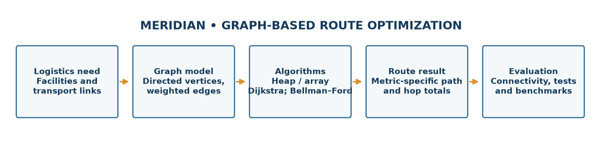

# Cover Page

MERIDIAN – GRAPH-BASED LOGISTICS NETWORK AND ROUTE OPTIMIZATION PLATFORM

**A PROJECT REPORT**

***Submitted by***

**Rishabh Singh (25BCS11466)**

***in partial fulfilment for the award of the degree of***

**BACHELOR OF ENGINEERING**

**IN**

Computer Science Engineering

Chandigarh University

November 2026

# Bonafide Certificate

## BONAFIDE CERTIFICATE

Certified that this project report entitled **“MERIDIAN – GRAPH-BASED LOGISTICS NETWORK AND ROUTE OPTIMIZATION PLATFORM”** is the bonafide work of **Rishabh Singh (UID: 25BCS11466; Class: 25BCS-707-A)**, who carried out the project work in partial fulfilment of the requirements for the Bachelor of Engineering in Computer Science Engineering, Chandigarh University.

The report is submitted for academic assessment in **Advanced Data Structure (25CSH-202), 3rd Semester**. The official names, designations, departments, signatures and examination date below are intentionally left blank for completion by the University.

| Official field | Entry |
|---|---|
| Supervisor name / academic designation | __________________________________ |
| Supervisor signature | __________________________________ |
| Department | __________________________________ |
| Head of Department | __________________________________ |
| HOD signature | __________________________________ |
| Examination date | __________________________________ |

Submitted for the project viva-voce examination held on: ______________________________

| Internal Examiner | External Examiner |
|---|---|
| Signature: __________________________ | Signature: __________________________ |
| Name/designation: ___________________ | Name/designation: ___________________ |

# Table of Contents

The Table of Contents is generated as a Word field after pagination. Update fields in Word if the document is edited.

# List of Figures

The List of Figures is generated from numbered figure captions after pagination.

# List of Tables

The List of Tables is generated from numbered table captions after pagination.

# List of Standards

Standards in this report are design and evaluation references only. The project does not claim certification or demonstrated conformance.

**Table P.1 – Standards considered as design references**

| Standard | Publishing Agency | About the Standard | Page Number |
|---|---|---|---|
| RFC 8259 (2017), The JavaScript Object Notation (JSON) Data Interchange Format | Internet Engineering Task Force (IETF) | Defines JSON syntax and interoperability expectations; relevant to the application's JSON request/response interface. Referenced as a design guide, not a conformance claim. | {{PAGEREF:std_json}} |
| ISO/IEC 25010:2023, Systems and software engineering — Systems and software Quality Requirements and Evaluation (SQuaRE) — Product quality model | International Organization for Standardization (ISO) / International Electrotechnical Commission (IEC) | Defines a software-product quality model used as a vocabulary for discussing functional suitability, reliability, performance efficiency, security and maintainability. It was considered for evaluation; no formal SQuaRE assessment was performed. | {{PAGEREF:std_quality}} |

# Abstract

Logistics planning can be represented as a shortest-path problem in which facilities and destinations are vertices and transport links are weighted, directed edges. A planner must distinguish the objective being minimized: monetary cost, distance and estimated travel time are not interchangeable. This project, Meridian, implements an interactive Flask application and SQLite-backed synthetic network to demonstrate graph modelling and shortest-path data structures in a reproducible setting.

The backend builds an edge list from persisted routes and creates adjacency lists for traversal. It provides Dijkstra's algorithm with a binary heap, an array-scan Dijkstra variant, and Bellman–Ford. Dijkstra is guarded against negative selected weights; Bellman–Ford supports negative edges and detects negative cycles. The API can dispatch an algorithm, reconstruct predecessor paths, compare implementations, generate benchmark graphs, calculate graph properties and provide network CRUD and analytics. A plain HTML/CSS/JavaScript interface presents the map, optimizer, comparison lab, manager, analytics and algorithm explanations.

On the seeded Standard scenario, the implementation reproduces 25 locations, 102 directed routes, density 0.17, mean out-degree 4.08, one weak component and strong connectivity. For the cost objective, the Cairo-to-Mexico City example returns CAI → MIL → FRA → HAM → NYC → HOU → MEX at $15,616, with separately aggregated distance 16,770 km and estimated time 540.6 h. A local test-client run produced the same route cost for all three algorithms; Dijkstra variants inspected 102 edges and Bellman–Ford inspected 510 in the compared run. The repository test suite passed 25 tests. Timings are environment-dependent; reported sample benchmark values are not universal performance guarantees. The network weights and route data are synthetic, so the project demonstrates algorithm behavior rather than operational logistics performance.

**Keywords:** weighted directed graph, adjacency list, binary heap, Dijkstra, Bellman–Ford, shortest path, logistics network, Flask, SQLite.

# Graphical Abstract

The report follows the prescribed five-chapter Chandigarh University structure: problem context and tasks; literature and graph-algorithm background; design choices and methodology; implementation/results/validation; and conclusion/future work.

# Abbreviations

**Table P.2 – Abbreviations used in this report**

| Abbreviation | Meaning |
|---|---|
| API | Application Programming Interface |
| BF | Bellman–Ford |
| CRUD | Create, Read, Update and Delete |
| CSE | Computer Science Engineering |
| DSU | Disjoint-Set Union |
| HTTP | Hypertext Transfer Protocol |
| IETF | Internet Engineering Task Force |
| ISO/IEC | International Organization for Standardization / International Electrotechnical Commission |
| JSON | JavaScript Object Notation |
| KPI | Key Performance Indicator |
| REST | Representational State Transfer |
| SCC | Strongly Connected Component |
| SQL | Structured Query Language |
| SVG | Scalable Vector Graphics |
| UID | University Identification Number |
| URL | Uniform Resource Locator |
| WSGI | Web Server Gateway Interface |

# Symbols

**Table P.3 – Mathematical symbols and notation**

| Symbol | Definition |
|---|---|
| G = (V, E) | Graph with vertex set V and directed edge set E |
| V | Number of vertices (locations) |
| E | Number of directed edges (routes) |
| w(u,v) | Selected weight of the directed edge u→v |
| d(v) | Current best-known source-to-v distance |
| dist(v) | Final shortest-path distance from the source, when finite |
| pred(v) | Predecessor of v on the current best path |
| ρ | Directed graph density, E/[V(V−1)] for a loop-free simple digraph |
| δ⁺(v) | Out-degree of vertex v |
| δ⁻(v) | In-degree of vertex v |
| ∞ | Unreachable/initial distance sentinel |
| −∞ | No finite minimum for a destination affected by a reachable negative cycle |
| O(·) | Asymptotic upper-bound notation |
| log V | Logarithm of V; base does not change the asymptotic class |
