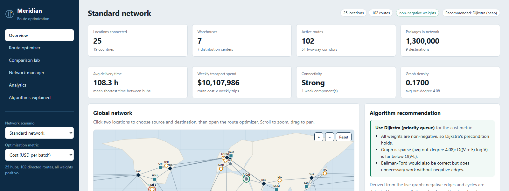

# USER MANUAL

The deployed application is available at **https://logistics-platform-t77a.onrender.com/**. The service may take time to wake from an idle state. User-interface behavior below was checked against the local implementation; the deployed Overview rendered after its cold start. No production network data was changed for this report.

## Access and basic navigation

1. Open the deployment URL in a modern browser and wait for the service to finish waking. If a loading screen persists, refresh after a short wait.
2. On **Overview**, review the selected network's locations, warehouses, routes, package count, mean shortest delivery time, weekly synthetic spend, connectivity and density. The map is a stylized network view.
3. Use **Network scenario** in the sidebar to select a built-in or generated network. The negative-edge and negative-cycle scenarios are algorithm tests, not realistic tariff data.
4. Use **Optimization metric** to choose cost, delivery time or distance. This changes the edge weights passed to the route calculation; it does not combine the objectives.
5. On the map, click two location markers to choose source and destination. The source/destination indicators update in the view. Scroll/drag behavior is described by the interface; use the route form if map selection is inconvenient.

## Calculate and interpret a route

6. Open **Route optimizer**. Confirm the source and destination dropdowns, choose **Auto (recommended)** or an explicit algorithm, and optionally enable alternatives.
7. Select **Calculate route**. If the selected metric has negative weights and a Dijkstra variant is chosen, the app explains why it is blocked; select Bellman–Ford for the negative-edge test scenario. A negative cycle can make the finite optimum undefined.
8. Read the selected-metric total and route path. Review the hop table for mode, distance, cost and estimated time. These are separately accumulated measures; the selected objective determines which one is minimized.
9. If alternatives are enabled and available, review the paths produced by single-link removal. They are not an exhaustive set of all k-shortest paths.

## Compare, benchmark and inspect the network

10. Open **Comparison lab**, choose endpoints and metric, then run the algorithm comparison. Applicable algorithms are compared on the same input; review agreement, status, edge checks and medians. Wall-clock values vary and should not be treated as portable guarantees.
11. In the scaling panel, enter/select vertex counts, repeats and average degree where the controls are available, then run the benchmark. The app shows random and Bellman–Ford worst-case generated graphs; benchmark runs do not use live transportation data.
12. Open **Network manager** to inspect network overview and scenario-generation controls. The verified application includes location and route creation/edit/removal, transport modes, route distance/cost/time/trips, bidirectional creation, sample network generation, and reset/delete safeguards. Editing these controls changes the selected database; do not make test edits to a production network.
13. Open **Analytics** to view mode spend/time/cost-per-kilometre, route-efficiency examples, connectivity and degree-ranked hubs. The figures summarize synthetic stored values and path calculations; they are not shipment telemetry.
14. Open **Algorithms explained** to read the application's algorithm guidance, preconditions and complexity comparison.

The deployment may differ from the locally inspected source version. If a control is unavailable or the service is still waking, do not infer successful behavior from the screenshot alone; use the status message and consult the current deployed interface.
